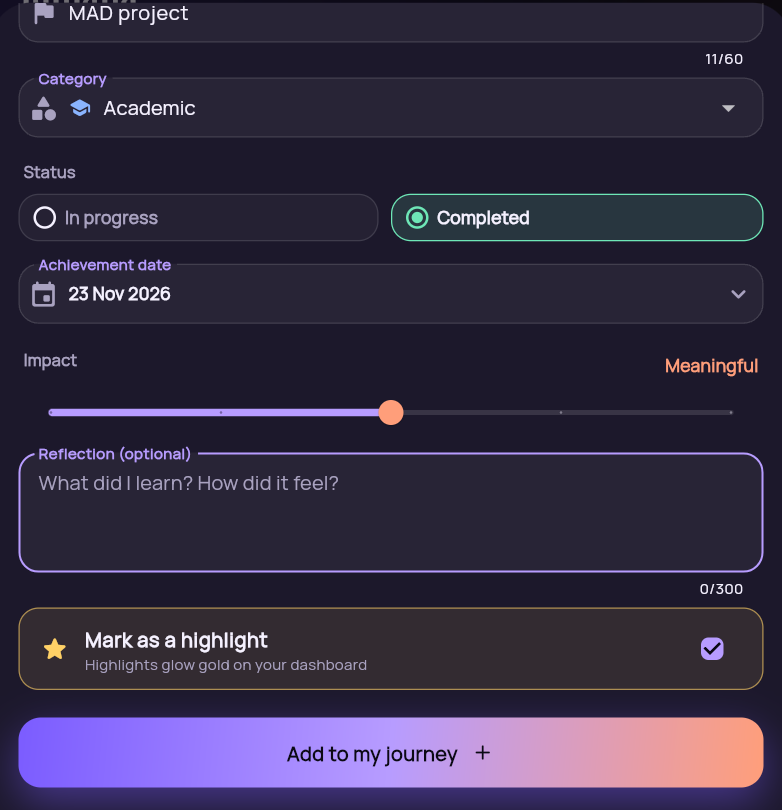

<div align="center">


# BECOMING

**Your journey, your growth.**

A private achievement journal for students and lifelong learners, built with Flutter and Firebase.


*CSSE3203 Mobile Application Development · Individual project*

</div>

---

## Table of contents

- [About the project](#about-the-project)
- [Features](#features)
- [Screenshots](#screenshots)
- [Tech stack](#tech-stack)
- [Getting started](#getting-started)
- [How to use the app](#how-to-use-the-app)
- [How it works](#how-it-works)
- [Project structure](#project-structure)
- [Troubleshooting](#troubleshooting)
- [Course requirements](#course-requirements)
- [Roadmap](#roadmap)

---

## About the project

Students and early-career professionals often lose track of their courses, projects, certificates and new skills. When it is time to write a CV or prepare for an interview, it is hard to remember everything.

**BECOMING** is one private place to:

- record every achievement, big or small
- organise it by **category** and **status**
- write a short **reflection** about what you learned
- see your **progress** at a glance

Each user has their own account, and their data is visible only to them.

---

## Features

### 🔐 Registration
- Full name, email, password and password confirmation
- Validation on every field (valid email, 6+ character password, matching passwords)
- Live password-strength bar (Weak, Fair, Good, Strong)
- Terms checkbox that must be ticked
- After registering, the user goes to the Login page with their email already filled in

### 🔑 Login
- Email and password validation, with a shake animation on wrong input
- Friendly Firebase error messages, such as *"Incorrect email or password"*
- **Forgot password** link that sends a reset email
- After login, the Back button cannot return to the Login page

### 🌟 My Journey dashboard
- Personal greeting and a **progress ring** showing the percentage completed
- Live statistics: total, in progress, highlights and entries this month
- **Search** by title or reflection, **category chips** and a **status filter**
- Achievement cards with category icon, status, date, impact and reflection
- Tap the circle to mark an achievement completed
- Swipe left or use the ⋯ menu to delete, with a confirmation dialog and **Undo**
- Log out with a confirmation dialog

### 📝 Add / edit form
| Field | Widget |
|---|---|
| Title (3 to 60 characters) | `TextFormField` |
| Category: Academic, Project, Skill, Certificate, Personal | `DropdownButtonFormField` |
| Status: In progress or Completed | `Radio` |
| Achievement date (a completed achievement cannot be in the future) | Date picker |
| Impact from 1 to 5 | `Slider` |
| Reflection (optional, up to 300 characters) | `TextFormField` |
| Mark as a highlight | `Checkbox` |

### 🎨 Design
- One shared dark theme with violet, lilac and peach accents
- Fraunces for headings and Manrope for body text
- Moving aurora background, staggered fade-in entrances, button press effects and counting animations

---

## Screenshots

<div align="center">

<br><em>The Add achievement form</em>
</div>

> Tip: add more screenshots of the Login page and the dashboard to `docs/screenshots/` and link them here.

---

## Tech stack

| Technology | Purpose |
|---|---|
| [Flutter](https://flutter.dev) and Dart | User interface, one code base for web, Android and Windows |
| [Firebase Authentication](https://firebase.google.com/docs/auth) | Email and password accounts |
| [Cloud Firestore](https://firebase.google.com/docs/firestore) | Cloud database for each user's achievements |
| [google_fonts](https://pub.dev/packages/google_fonts) | Fraunces and Manrope fonts |
| Material 3 | Modern widgets and theming |

---

## Getting started

### 1. Prerequisites

Install these first:

- [Flutter SDK](https://docs.flutter.dev/get-started/install) (tested with Flutter 3.24.3 and Dart 3.5)
- [Visual Studio Code](https://code.visualstudio.com/) with the **Flutter** and **Dart** extensions
- [Google Chrome](https://www.google.com/chrome/) to run the app on the web
- [Node.js](https://nodejs.org/) (LTS), needed for the Firebase command-line tools
- A Google account for [Firebase](https://console.firebase.google.com/)

Check that Flutter works:

```bash
flutter doctor
```

### 2. Get the code

```bash
git clone https://github.com/jumanaahmed004-svg/becoming-flutter-app.git
cd becoming-flutter-app
flutter pub get
```

### 3. Set up Firebase

The project already contains `lib/firebase_options.dart` for the original Firebase project. To use **your own** Firebase project:

1. **Create a project** at [console.firebase.google.com](https://console.firebase.google.com/).
2. **Install the tools:**
   ```bash
   npm install -g firebase-tools
   firebase login
   dart pub global activate flutterfire_cli
   ```
3. **Connect the app** (run inside the project folder). This replaces `lib/firebase_options.dart`:
   ```bash
   flutterfire configure
   ```
   If Windows says `flutterfire` is not recognised, use:
   ```bash
   dart pub global run flutterfire_cli:flutterfire configure
   ```
4. **Turn on sign-in:** in the console, open **Authentication → Get started → Sign-in method → Email/Password**, switch it on and save.
5. **Create the database:** open **Firestore Database → Create database**, keep the ID as `(default)`, choose a location, and start in production mode.
6. **Publish the security rules:** open the **Rules** tab, paste the contents of [`firestore.rules`](firestore.rules), and click **Publish**.

### 4. Run the app

```bash
flutter run -d chrome
```

Chrome opens with the app. While it runs, press `r` in the terminal for a hot reload or `R` for a full restart.

You can also run it on an Android emulator or phone with `flutter run`, or on Windows with `flutter run -d windows` (Windows needs Developer Mode turned on).

---

## How to use the app

1. **Create an account.** On the Login page, tap **Create an account**, fill in the form, accept the terms and press **Create account**.
2. **Log in** with your new email and password.
3. **Add an achievement.** Press **New achievement**, fill in the form and press **Add to my journey**.
4. **View your progress.** The ring and the statistics update instantly.
5. **Find achievements** using the search box, the category chips or the All / In progress / Completed switch.
6. **Edit** by tapping a card, changing the details and pressing **Save changes**.
7. **Mark as completed** by tapping the round circle on a card.
8. **Delete** by swiping a card left or choosing **Delete** from the ⋯ menu. Confirm, or press **Undo** to bring it back.
9. **Log out** with the icon at the top right.

---

## How it works

### Navigation

`AuthGate` in `main.dart` listens to `FirebaseAuth.instance.authStateChanges()`:

```
Not signed in  →  Login page  ⇄  Registration page
Signed in      →  My Journey dashboard
```

Because the pages are swapped rather than pushed, the Back button never returns to Login after signing in, or to the dashboard after logging out.

### Data model

Each achievement is a Firestore document at:

```
users/{uid}/achievements/{achievementId}
```

| Field | Type | Example |
|---|---|---|
| `title` | string | "Completed my first Flutter app" |
| `category` | string | "Project" |
| `status` | string | "Completed" |
| `achievementDate` | timestamp | 20 Nov 2026 |
| `reflection` | string | "Learned to work with Firebase" |
| `impact` | number (1 to 5) | 3 |
| `isFeatured` | boolean | true |
| `createdAt` / `updatedAt` | server timestamp | |

Passwords are never stored in Firestore. Firebase Authentication handles them.

### CRUD operations

All database code is in `lib/services/achievement_service.dart`.

| Operation | What the user does | Firestore method |
|---|---|---|
| **Create** | Adds a new achievement | `collection.add()` |
| **Read** | Sees a live list on the dashboard | `snapshots()` with `StreamBuilder` |
| **Update** | Edits a card or marks it completed | `doc(id).update()` |
| **Delete** | Removes an achievement after confirming | `doc(id).delete()` |

### Security rules

[`firestore.rules`](firestore.rules) makes sure each user can only reach their own data, and checks the data before it is saved:

```js
match /users/{uid}/achievements/{id} {
  allow read, delete: if request.auth != null && request.auth.uid == uid;
  allow create, update: if request.auth != null && request.auth.uid == uid
    && request.resource.data.title is string
    && request.resource.data.title.size() > 0
    && request.resource.data.category is string
    && request.resource.data.status in ['In progress', 'Completed'];
}
```

---

## Project structure

```
becoming-flutter-app/
├── lib/
│   ├── main.dart                     # Firebase start-up, AuthGate and splash screen
│   ├── theme.dart                    # Colours, fonts and shared styles
│   ├── auth_errors.dart              # Friendly Firebase error messages
│   ├── firebase_options.dart         # Generated by flutterfire configure
│   ├── models/
│   │   └── achievement.dart          # Achievement data model and categories
│   ├── services/
│   │   └── achievement_service.dart  # All Firestore CRUD operations
│   ├── screens/
│   │   ├── register_page.dart        # Page 1: Registration
│   │   ├── login_page.dart           # Page 2: Login
│   │   ├── dashboard_page.dart       # Page 3: My Journey dashboard
│   │   └── achievement_sheet.dart    # Add / edit form
│   └── widgets/                      # Reusable UI and animations
│       ├── auth_shell.dart           # Shared layout for Login and Registration
│       ├── aurora_background.dart    # Animated background
│       ├── gradient_button.dart      # Main button with loading state
│       ├── app_feedback.dart         # SnackBars and confirmation dialogs
│       └── ...
├── assets/images/                    # App illustration
├── test/widget_test.dart             # Unit tests
├── firestore.rules                   # Firestore security rules
└── pubspec.yaml                      # Dependencies and assets
```

---

## Troubleshooting

| Problem | Fix |
|---|---|
| `npm` is not recognised | Install Node.js, then restart VS Code. |
| `running scripts is disabled on this system` | In PowerShell, run `Set-ExecutionPolicy RemoteSigned -Scope CurrentUser`, or use `npm.cmd` instead of `npm`. |
| `flutterfire` is not recognised | Use `dart pub global run flutterfire_cli:flutterfire configure`. |
| Red lines on `firebase_options.dart` | Run `flutterfire configure` to generate the file. |
| `configuration-not-found` when registering | Enable **Email/Password** in Firebase **Authentication**. |
| "Could not load your journey" / `permission-denied` | Create the Firestore database and publish `firestore.rules`. |
| The add form keeps loading | The Firestore database has not been created yet. |
| `Building with plugins requires symlink support` | Only needed for Windows desktop: turn on Developer Mode, or run in Chrome instead. |
| Fonts look different the first time | `google_fonts` downloads the fonts on first launch, so an internet connection is needed. |

---

## Course requirements

| Requirement | How BECOMING meets it |
|---|---|
| At least 3 pages | Registration, Login, My Journey dashboard |
| Images on at least one page | Illustration on Login, Registration and the empty dashboard |
| Validation and error messages | Validators on every field, plus Firebase error messages |
| 5+ interactive widget types | TextFormField, Dropdown, Radio, Checkbox, Date picker, Slider, ElevatedButton, AlertDialog, SnackBar |
| Multi-user Firebase Authentication | Email and password accounts, each with private data |
| At least 2–3 CRUD operations | All four: create, read, update, delete |
| Firestore or Realtime Database | Cloud Firestore with security rules |
| Consistent UI and navigation | One shared theme and AuthGate navigation |

---

## Roadmap

- [ ] Upload certificate images with Firebase Storage
- [ ] Charts showing growth by category
- [ ] Goal reminders with notifications
- [ ] Export the journey as a portfolio PDF
- [ ] Light and dark theme switch

---

## Author

**Jumana Albalushi**, Software Engineer <br>

---

<div align="center">

Made with 💜 by **SE Jumana Albalushi**
<br>
Flutter · Firebase · CSSE3203 Mobile Application Development

</div>
